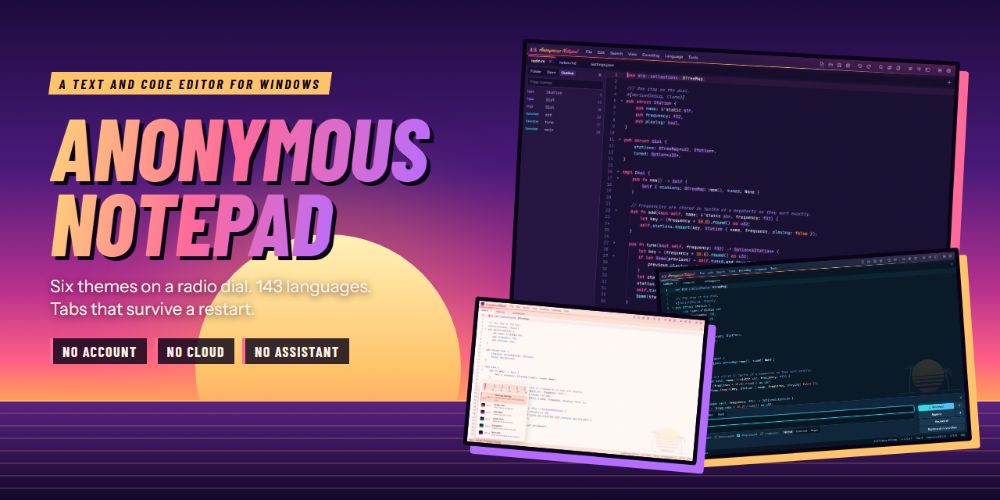
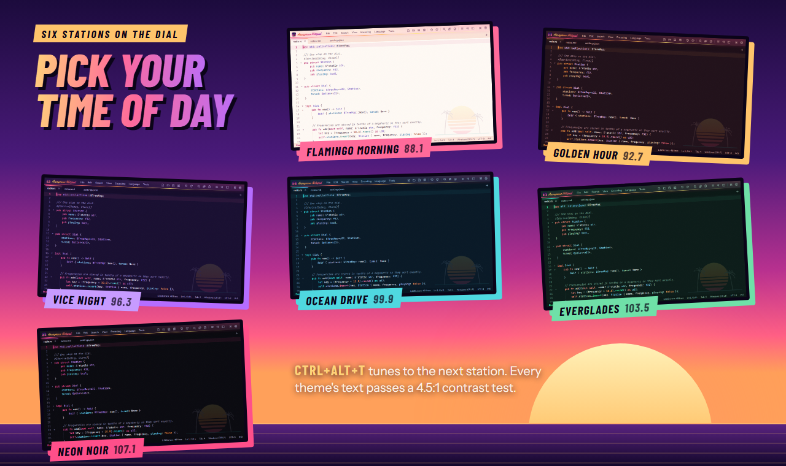

<p align="center">
  
</p>

<p align="center">
  <a href="https://github.com/ElDiablo66/anonymous-notepad/releases/latest"></a>
</p>
<p align="center">
  
  
  <a href="LICENSE"></a>
  
</p>

# Anonymous Notepad

A text and code editor for Windows that looks like dusk on a Florida causeway: pink and orange sunsets, palm trees, neon on dark water. Tabs survive a restart, search reaches across whole folders, and the everyday text chores are built in. There is no account, no cloud and no assistant.

The file work is written in Rust. The window is a [Tauri 2](https://tauri.app) app and the editor is [CodeMirror 6](https://codemirror.net).


## Why I made it

I wanted the editor I open every day to look like somewhere I'd want to be at 2 am, and to fix the things people keep asking other editors for. The look is my take on the neon Miami of 1980s crime shows and of games like the Vice City series. Every picture, colour and icon in it was made for this project.

The feature list comes from reading what Notepad++ and Windows Notepad users ask for. The notes and their sources are in [docs/research.md](docs/research.md), and the plan is in [docs/roadmap.md](docs/roadmap.md).

## Themes

<p align="center">
  
</p>

- Six themes sit as stations on a radio dial in the status bar. `Ctrl+Alt+T` tunes to the next one.
- Flamingo morning is the light theme and Neon noir the high-contrast one; the other four are dusk themes.
- Neon glow has three levels: off, soft (the frame only) or full (the code glows too).
- Every theme's text and code colours are tested to a contrast of at least 4.5:1.
- The toolbar, the start screen and the corner sunset can each be switched off in Preferences.
- The interface grows with the window, so menus, tabs and panels don't look lost on a wide screen. Sizes from 100% to 200% can also be set by hand.

## What the editor does

- Tabs come back after a restart, including text you never saved. A file is read the first time you look at its tab, so a session with hundreds of tabs still opens at once. Closing the app doesn't ask about unsaved tabs; closing one tab does. The session file keeps a backup copy of itself.
- It can save when the window loses focus.
- Syntax colours for 143 languages, picked from the file name or by hand (`Ctrl+Shift+G`).
- Find and replace in normal, extended (`\n`, `\t`, `\x41`) and regular expression mode, with a count, find all in open files and a results list you can click through.
- Find in files runs across a folder on every processor core, with name filters such as `*.rs; *.toml; !*.lock`.
- Files over 50 MB open in a read-only viewer that reads only the lines on screen, with its own go-to-line and find.
- Bookmarks in the margin, and five highlight colours for marking every occurrence of a word.
- Line tools: 14 sorts, remove duplicates, remove empty lines, reverse, shuffle, join, split, trim, tabs to spaces and back.
- Case tools, a column editor for text or number series, multiple cursors (`Ctrl` and click) and column selection (`Alt` and drag).
- JSON format and minify, Base64 and URL encode and decode, and MD5, SHA-1, SHA-256 and SHA-512 of text or files.
- UTF-8 with or without BOM, UTF-16 LE and BE, and 22 legacy code pages. A file is saved in the encoding it was read in. Line endings are detected and can be converted.
- A side panel with a folder tree, the open files and an outline of functions, classes and headings.
- A command list (`Ctrl+Shift+P`) that searches every action.


## How it compares

As of November 2026, from the sources in [docs/research.md](docs/research.md).

| | Anonymous Notepad | Notepad++ | Windows Notepad |
| --- | --- | --- | --- |
| Unsaved tabs survive a restart | Yes | Yes | Yes |
| Save on focus loss | Built in | Plugin | No |
| Install without administrator rights | Yes | Open request | Preinstalled |
| Account or AI features | None | None | AI tools with a Microsoft account |
| Syntax colours, regex, line tools | Yes | Yes | No |
| JSON, Base64 and URL tools | Built in | Plugins | No |
| Themes cover every panel | Yes | Not plugin dialogs | Light and dark only |
| Plugins and macros | No | Yes | No |
| Very large files | Read-only viewer, tested at 2 GB | Larger, with mixed reports | Opens up to about 1 GB |

Notepad++ is a native program, so it stays lighter on memory and quicker to start. This editor draws its text in a web view; the heavy jobs (searching folders, reading huge files) run in Rust.

## Speed

Measured on a 16-core desktop PC with the benchmark in this repository. Your numbers will differ.

| Job | Result |
| --- | --- |
| Find in files, 12,033 files, no matches | 77 ms on all cores, 775 ms on one |
| Find in files, 12,033 files, 44,308 matches | 680 ms on all cores, 1,689 ms on one |
| Open a 2 GB log (30.4 million lines) in the viewer | 0.9 s |
| Read 120 lines from the middle and the end of that file | 15 microseconds |
| Find text on the last line of that file | 0.12 s |


<details>
<summary>Run the benchmark yourself</summary>

```powershell
cargo run --release --manifest-path src-tauri/Cargo.toml --example bench -- find C:\some\folder function
```

```powershell
cargo run --release --manifest-path src-tauri/Cargo.toml --example bench -- make C:\temp\big.log 2048
```

```powershell
cargo run --release --manifest-path src-tauri/Cargo.toml --example bench -- big C:\temp\big.log needle
```

</details>

## Install

1. Open the [latest release](https://github.com/ElDiablo66/anonymous-notepad/releases/latest) and download `Anonymous-Notepad-<version>-setup.exe`.
2. Run it. It installs for your user only and needs no administrator rights.
3. The installer isn't code signed, so Windows SmartScreen warns the first time. Choose "More info", then "Run anyway". Each release lists the file's SHA-256 if you want to check your download.

To update, run the newer installer over the old one. Your tabs and preferences are kept. Windows 11 is the only system it has been built and tried on.

## Keys worth knowing

| Action | Key |
| --- | --- |
| Command list | `Ctrl+Shift+P` |
| Next theme station | `Ctrl+Alt+T` |
| Find, replace, find in files | `Ctrl+F`, `Ctrl+H`, `Ctrl+Shift+F` |
| Go to line | `Ctrl+G` |
| Toggle, next, previous bookmark | `Ctrl+F2`, `F2`, `Shift+F2` |
| Duplicate line, delete line | `Ctrl+D`, `Ctrl+Shift+L` |
| Move line up or down | `Ctrl+Shift+Up`, `Ctrl+Shift+Down` |
| Toggle comment | `Ctrl+Q` |
| Format JSON | `Ctrl+Alt+J` |
| Column editor | `Alt+C` |
| Reopen closed file | `Ctrl+Shift+T` |
| Distraction free, full screen | `F12`, `F11` |
| Preferences | `Ctrl+,` |

The full list is under Tools, Keyboard shortcuts.

## Where your data lives

Open tabs, unsaved text and preferences are kept in `%APPDATA%\app.anonymousnotepad.desktop\` as `session.json`, `session-backup.json` and `settings.json`. Delete them to start clean.

The app makes no network requests and has no updater. The "Search the web for the selection" command opens your own browser at the address set in Preferences.

## Known limits

- The installed app has had little real-world use so far. Expect rough edges and please [report them](https://github.com/ElDiablo66/anonymous-notepad/issues).
- The editor keeps the whole file in memory, which is why files over 50 MB go to the read-only viewer. The viewer reads UTF-8 and single-byte text and refuses UTF-16. It shows the file as it was when opened and doesn't follow a file that is still growing.
- Find in files uses Rust regular expressions and find in the editor uses JavaScript ones, so lookbehind and backreferences work in the editor only.
- No printing, macro recording, split view, plugins or replace in files yet. See the [roadmap](docs/roadmap.md).
- The outline is pattern based. It covers 30 languages and can miss unusual code layouts.

## Build from source

You need [Node.js](https://nodejs.org), [Rust](https://rustup.rs) and the Microsoft C++ build tools that Rust asks for on Windows. The project is built with Node.js 24 and Rust 1.99; older versions are untested.

```powershell
git clone https://github.com/ElDiablo66/anonymous-notepad.git
```

```powershell
cd anonymous-notepad
```

```powershell
npm install
```

```powershell
npm run tauri build
```

The installer lands in `src-tauri/target/release/bundle/nsis/`. For live reload use `npm run tauri dev`. To see the interface in a browser with sample tabs, run `npm run dev` and open `http://localhost:5184/?demo`; add `&theme=ocean-drive`, `&glow=full` or `&panel=start` for other states.

Tests, the checks a pull request needs and a map of the source are in [CONTRIBUTING.md](CONTRIBUTING.md).

## Contributing and support

Bug reports, ideas and pull requests are welcome; [CONTRIBUTING.md](CONTRIBUTING.md) has the set-up and the two rules about artwork and the network. Questions go to [SUPPORT.md](SUPPORT.md), and security problems to [SECURITY.md](SECURITY.md).

## Licence

[MIT](LICENSE). You can use, change and share the code, including in closed projects, as long as the copyright notice stays with it. The packages it is built on keep their own licences: the short list is in [THIRD-PARTY.md](THIRD-PARTY.md), and the installer carries the full texts.

## Disclaimer

Anonymous Notepad is a fan-made, independent project. It is not affiliated with, endorsed by or connected to Rockstar Games, Take-Two Interactive, or the Notepad++ project. Grand Theft Auto and Vice City are trademarks of Take-Two Interactive Software. This project contains no artwork, fonts, logos, names or code from any of them: the art is original and the program was written from scratch.
