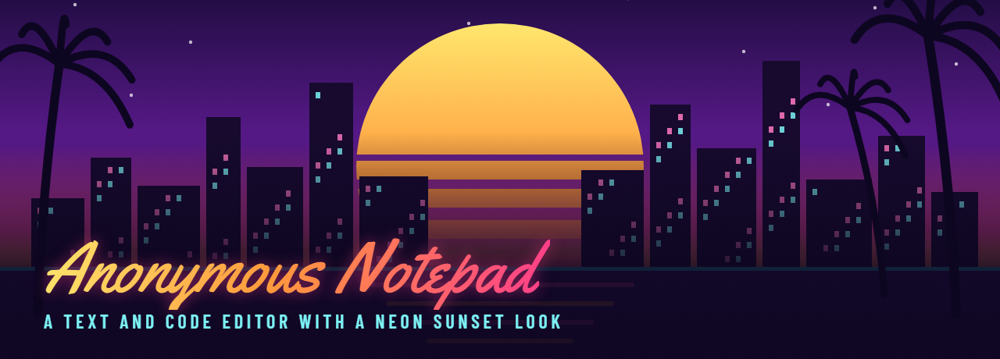

# Anonymous Notepad

A text and code editor for Windows that looks like a neon night on the coast: sunset gradients, palm trees, pink and teal light. Tabs survive a restart, search reaches across folders, and the common text chores are built in. No account, no cloud, no assistant.

The file work is written in Rust. The window is a [Tauri v2](https://tauri.app) app and the editor is [CodeMirror 6](https://codemirror.net).

[](https://github.com/ElDiablo66/anonymous-notepad/actions/workflows/checks.yml)


## Why it exists

I wanted the editor I reach for every day to look like a place I would want to be at 2 am, and to fix the things people keep asking other editors for. The look is my take on the neon Miami of 1980s crime shows and of games like the Vice City series. Every picture, colour and icon in it was made for this project.

The feature choices come from reading what users of Notepad++ and Windows Notepad ask for. The notes and their sources are in [docs/research.md](docs/research.md), and the plan is in [docs/roadmap.md](docs/roadmap.md).

## Features

### The look

- Six themes, laid out as stations on a radio dial in the status bar. `Ctrl+Alt+T` tunes to the next one.
- A light theme (Flamingo morning) and a high-contrast one (Neon noir) alongside the four dusk themes.
- Neon glow in three levels: off, soft (the frame only) or full (the code glows too).
- Every theme's text and code colours are tested to a contrast of at least 4.5:1.
- All of it can be switched off in Preferences, including the toolbar, the start screen and the corner sunset.

| | | |
| --- | --- | --- |
|  Flamingo morning, 88.1 |  Golden hour, 92.7 |  Vice night, 96.3 |
|  Ocean drive, 99.9 |  Everglades, 103.5 |  Neon noir, 107.1 |


### The editor

- Tabs that come back after a restart, including text you never saved. Closing the app does not ask about unsaved tabs; closing a single tab does. The session file keeps a backup copy of itself.
- Optional saving when the window loses focus.
- Syntax colours for 143 languages, picked from the file name or by hand (`Ctrl+Shift+G`).
- Find and replace in normal, extended (`\n`, `\t`, `\x41`) and regular expression mode, with count, find all in open files and a results list you can click through.
- Find in files across a folder, with name filters such as `*.rs; *.toml; !*.lock`.
- Bookmarks in the margin and five highlight colours for marking every occurrence of a word.
- Line tools: 14 sorts, remove duplicates, remove empty lines, reverse, shuffle, join, split, trim, tabs to spaces and back.
- Case tools, a column editor for text or number series, multiple cursors (`Ctrl` and click) and column selection (`Alt` and drag).
- Format and minify JSON, Base64 and URL encode and decode, and MD5, SHA-1, SHA-256 and SHA-512 of text or files.
- Encodings: UTF-8 with or without BOM, UTF-16 LE and BE, and 22 legacy code pages. A file is saved in the encoding it was read in. Line endings are detected and can be converted.
- A side panel with a folder tree, the open files and an outline of functions, classes and headings.
- A command list (`Ctrl+Shift+P`) that searches every action.


## How it compares

As of November 2026, from the sources in [docs/research.md](docs/research.md).

| | Anonymous Notepad | Notepad++ | Windows Notepad |
| --- | --- | --- | --- |
| Unsaved tabs survive a restart | Yes | Yes | Yes |
| Save on focus loss | Built in | Plugin | No |
| Install without administrator rights | Yes | Open request | Preinstalled |
| Account or AI features | None | None | AI tools with a Microsoft account |
| Syntax colours, regex, line tools | Yes | Yes | No |
| JSON, Base64 and URL tools | Built in | Plugins | No |
| Themes cover every panel | Yes | Not plugin dialogs | Light and dark only |
| Plugins and macros | No | Yes | No |
| Very large files | Refuses over 256 MB | Larger, with mixed reports | Opens up to about 1 GB |

Notepad++ is a native program and stays lighter on memory and faster on big files. This editor draws its text in a web view.

## Install

There is no published release yet. Until the first one is on the [Releases](https://github.com/ElDiablo66/anonymous-notepad/releases) page, build the installer yourself (next section) and run the `.exe` it produces. It installs for the current user and needs no administrator rights.

Windows 11 is the only system it has been built on.

## Build from source

You need [Node.js](https://nodejs.org), [Rust](https://rustup.rs) and the Microsoft C++ build tools that Rust asks for on Windows. The project is built with Node.js 24 and Rust 1.99; older versions are untested.

```powershell
git clone https://github.com/ElDiablo66/anonymous-notepad.git
```

```powershell
cd anonymous-notepad
```

```powershell
npm install
```

```powershell
npm run tauri build
```

The installer lands in `src-tauri/target/release/bundle/nsis/`.

To work on the app with live reload:

```powershell
npm run tauri dev
```

To look at the interface in a browser with sample tabs, run `npm run dev` and open `http://localhost:5184/?demo`. Add `&theme=ocean-drive`, `&glow=full` or `&panel=start` to see other states.

## Tests

```powershell
npm test
```

```powershell
cargo test --manifest-path src-tauri/Cargo.toml
```

`npm test` covers the line, case, number and conversion tools and checks the contrast of every theme. `cargo test` covers encoding detection and round trips, line endings, find in files, file filters, the hashes and the session backup. Run `npm run build` and `npm run notices` once before `cargo test`, because the Rust build expects the web files and the notices file to exist.

## Keys worth knowing

| Action | Key |
| --- | --- |
| Command list | `Ctrl+Shift+P` |
| Next theme station | `Ctrl+Alt+T` |
| Find, replace, find in files | `Ctrl+F`, `Ctrl+H`, `Ctrl+Shift+F` |
| Find next and previous | `F3`, `Shift+F3` |
| Go to line | `Ctrl+G` |
| Toggle, next, previous bookmark | `Ctrl+F2`, `F2`, `Shift+F2` |
| Duplicate line, delete line | `Ctrl+D`, `Ctrl+Shift+L` |
| Move line up or down | `Ctrl+Shift+Up`, `Ctrl+Shift+Down` |
| Toggle comment | `Ctrl+Q` |
| Format JSON | `Ctrl+Alt+J` |
| Column editor | `Alt+C` |
| Reopen closed file | `Ctrl+Shift+T` |
| Distraction free, full screen | `F12`, `F11` |
| Preferences | `Ctrl+,` |

The full list is under Tools, Keyboard shortcuts.

## Where your data lives

Open tabs, unsaved text and preferences are kept in `%APPDATA%\app.anonymousnotepad.desktop\`: `session.json`, `session-backup.json` and `settings.json`. Delete them to start clean.

The app makes no network requests and has no updater. The "Search the web for the selection" command opens your own browser at the address set in Preferences.

## Known limits

- The installed app has had little real-world use so far. Expect rough edges and please [report them](https://github.com/ElDiablo66/anonymous-notepad/issues).
- The editor keeps the whole file in memory. Files of a few megabytes are fine; files over 256 MB are refused.
- Find in files uses Rust regular expressions; find in the editor uses JavaScript ones. Lookbehind and backreferences work in the editor only.
- No printing, macro recording, split view, plugins or replace in files yet. See the [roadmap](docs/roadmap.md).
- The outline is pattern based. It covers 30 languages and can miss unusual code layouts.

## Project layout

| Part | Where |
| --- | --- |
| Reading, writing, encodings, folder listing | `src-tauri/src/files.rs` |
| Find in files | `src-tauri/src/search.rs` |
| Hashes, saved session, command line | `src-tauri/src/lib.rs` |
| Editor set-up, bookmarks, marks | `src/editor/` |
| Every command, the menus and the keys | `src/commands.ts` |
| Themes and their places on the dial | `src/themes.ts`, `src/styles.css` |
| Line, case, number and conversion tools | `src/textops.ts` |
| Interface | `src/components/` |
| Logo, banner and screenshots | `Design/` |
| Research and roadmap | `docs/` |

## Contributing

Bug reports, ideas and pull requests are welcome. [CONTRIBUTING.md](CONTRIBUTING.md) has the set-up, the checks to run and the two rules about artwork and the network.

## Licence

[MIT](LICENSE). You can use, change and share the code, including in closed projects, as long as the copyright notice stays with it.

The packages this app is built on keep their own licences. The short list is in [THIRD-PARTY.md](THIRD-PARTY.md), and the installer carries the full texts.

## Disclaimer

Anonymous Notepad is a fan-made, independent project. It is not affiliated with, endorsed by or connected to Rockstar Games, Take-Two Interactive, or the Notepad++ project. Grand Theft Auto and Vice City are trademarks of Take-Two Interactive Software. This project contains no artwork, fonts, logos, names or code from any of them: the art is original and the program was written from scratch.
